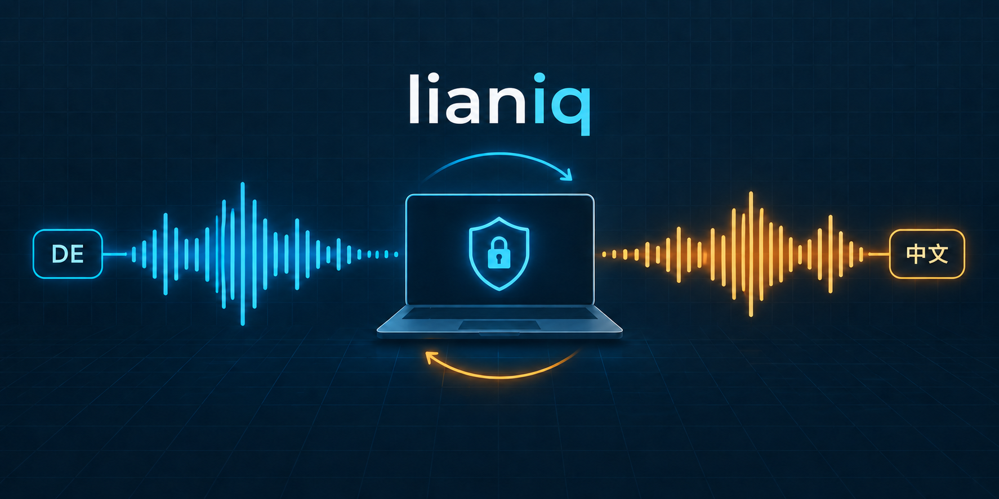

# lianiq



[](https://github.com/boris-heuer/lianiq/actions/workflows/ci.yml)
[](https://github.com/boris-heuer/lianiq/actions/workflows/codeql.yml)
[](LICENSE)

**Private, offline German-Mandarin speech translation for Windows.**

`lianiq` is a Windows desktop prototype for private, **near-real-time, utterance-based** conversations between
German and Mandarin Chinese. Audio is segmented at pauses, then transcribed, translated, and spoken;
it is not a simultaneous or word-by-word interpreter. Runtime audio processing and model inference
are local after the one-time model download.

> **Prototype status.** Results depend on language, noise, speakers, and hardware. Verify important
> conversations independently. The experimental Call Bridge is disabled by default and must not be
> used for calls until its hardware and call-application acceptance gates are complete.

The image above is the repository social-preview asset; it is an abstract illustration, not an
application screenshot or a performance claim.

### Application UI


This screenshot was captured from the Windows application by
`scripts/capture_readme_screenshot.py` with generic device selections, empty transcript panels, a
synthetic held turn in the held-turn bar, and the experimental Call Bridge disabled. It predates the
sidebar shell described under [Run](#run): it still shows the device selectors, *Model profile*,
**CUDA GPU** and the Call Bridge panel in one window. Recapture it on Windows with the same script
to show the shell. It is not evidence that the hardware, latency, reconnect, or real-call acceptance
gates passed.

## Reference system and portability

The defaults were developed on this reference system:

- AMD Ryzen AI 7 350, 8 cores / 16 threads
- 64 GB RAM
- AMD Radeon 860M without CUDA support
- Windows 11 Pro and Python 3.12

Faster-Whisper `small` uses CTranslate2 CPU INT8 and MarianMT uses CPU worker threads. The Radeon
is not assumed to provide CUDA. This is a reference configuration, not a hardware requirement:
use the device selectors and measure the actual latency on your system with `scripts/benchmark.py`.

The default `auto` device setting selects CUDA independently for CTranslate2, PyTorch, and ONNX
Runtime when each backend reports a usable NVIDIA GPU. Any unavailable backend falls back to the
CPU, so a partial or missing CUDA installation does not prevent the application from starting.

## Architecture

```text
Microphone (16 kHz mono)
  -> energy-based speech and pause detection
  -> bounded real-time queue
  -> Faster-Whisper small (CPU INT8)
  -> MarianMT, one model per translation direction of the selected language pair
  -> voice per language: Piper (German), sherpa-onnx (Mandarin)
  -> selected speakers
```

Microphone processing is muted while a voice speaks, preventing the application from translating
its own output. If the bounded queue fills, the oldest pending segment is dropped to prevent the
conversation from accumulating increasing delay.

Languages are identified by BCP 47 language IDs from a built-in registry (`de` German,
`zh-Hans` Mandarin (Simplified)); English, Spanish, and French are listed as planned and cannot be
selected yet. Automatic routing detects and routes every completed utterance independently, but
only within the selected language pair. It never assumes that participants alternate, so any number
of German or Mandarin turns may occur consecutively. See
[`docs/conversation-architecture.md`](docs/conversation-architecture.md) for multi-participant
scenarios, overlap limitations, and the TDD strategy.

## Experimental Call Bridge

The disabled-by-default Call Bridge places the application between a local headset and a call
application that permits explicit microphone and speaker selection, such as WeChat. Two independent,
fixed-direction translation lanes connect the
physical headset to two virtual audio cables without exposing the physical microphone directly to
the call application.

### Compatibility and limitations

The Call Bridge does **not** claim compatibility with every headset or communication application.
It is designed for Windows 11 audio devices that expose separate, unambiguous capture and playback
endpoints, and for desktop call applications that can route their microphone and speaker
independently to the two virtual cables. A technically compatible device selector is not evidence
that a real call, reconnect behavior, latency, or audio isolation has passed.

| Call application | Design assessment | lianiq real-call evidence | Production SystemOK |
|---|---|---|---|
| WeChat Desktop | Compatible in principle; it is the reference acceptance target | Pending | No |
| Microsoft Teams desktop | Compatible in principle where separate Speaker and Microphone selectors are available | Not run | No |
| WhatsApp for Windows | Conditional; the required independent TX/RX endpoint mapping must be confirmed for the installed version | Not run | No |
| Telegram Desktop | Conditional; the required endpoint controls and Windows microphone access must be confirmed for the installed version | Not run | No |
| Other desktop call applications | Conditional on explicit, independent microphone and speaker routing | Not run | No |

USB and wired headsets are generally the most predictable, but still require endpoint and real-call
validation. Bluetooth headsets may switch to a lower-quality mono/telephony profile or expose
different endpoints while their microphone is active. Compatibility depends on Windows, the
Bluetooth adapter and driver, and the exact headset model.

See the [Call Bridge compatibility policy](docs/call-bridge-compatibility.md) for support terms,
application evidence, headset constraints, and the acceptance required before changing any row to
`SystemOK`.

- [`docs/call-bridge-architecture.md`](docs/call-bridge-architecture.md) defines the technical
  architecture and audio routing decisions.
- [`docs/call-bridge-implementation-plan.md`](docs/call-bridge-implementation-plan.md) contains the
  risk assessment, TDD work order, scenarios, and acceptance gates.
- [`docs/call-bridge-system-ok.md`](docs/call-bridge-system-ok.md) records automated evidence and
  the remaining packaged-device/real-call production gates.
- [`docs/call-bridge-operator-setup.md`](docs/call-bridge-operator-setup.md) defines the Windows and
  call-application device mapping and real-call acceptance procedure.

The application persists native Windows MMDevice identities and resolves the current WASAPI index
at runtime. Missing or ambiguous devices mute the affected lane; they never fall back to a Windows
default endpoint. The lanes are fixed for a Call Bridge session: the local lane translates from
`call_bridge.local_language` (default `de`) to the other language of the selected pair, and the
remote lane translates back. Before any lane starts, the Call Bridge checks every model, both
voices, and all four endpoints, and names each missing item instead of starting.

The synthetic self-test needs no models. It checks that both lanes stay fixed for the session and
that a missing lane voice fails closed and is named. The model-backed run without `--synthetic`
needs every model and both voices. Both are local checks, not proof of safe hardware routing or a
working real call:

```powershell
.\.venv\Scripts\python.exe .\scripts\call_bridge_self_test.py --synthetic
.\.venv\Scripts\python.exe .\scripts\call_bridge_self_test.py
```

## Windows installation

Run in PowerShell from the project directory:

```powershell
Set-ExecutionPolicy -Scope Process Bypass
.\scripts\setup.ps1
```

The script:

1. creates a Python 3.12 virtual environment in `.venv`,
2. installs the hash-locked Windows dependencies and the application,
3. downloads Faster-Whisper, both MarianMT models, the German Piper voice, and the Mandarin
   sherpa-onnx voice (pinned archive, size and SHA-256 verified),
4. validates the installation with the offline doctor.

Model download is the only setup step that requires internet access. Existing downloads are reused
from the Hugging Face cache. Spoken output is off by default (`languages.output` is `text`). The
Mandarin voice is the sherpa-onnx model in `models/sherpa/vits-icefall-zh-aishell3/`
(`tts.engines["zh-Hans"]`; see [MODEL_LICENSES.md](MODEL_LICENSES.md)); German uses Piper. To
validate an existing installation without requesting models:

```powershell
.\.venv\Scripts\python.exe .\scripts\doctor.py
```

The doctor prints the readiness of each capability of the configured language pair: speech
recognition per language, translation per direction (for example `de>zh-Hans` and `zh-Hans>de`), and
the voice per language. A status is `not_configured`, `missing`, `installed` (files present),
`validated` (files match `models/model-manifest.json`), or `invalid` (files do not match).
Recognition and both translation directions are required. A missing voice is a warning, because
spoken output in that language then stays unavailable while text output works. Add
`--require-voices` to require the voices of both languages.

## Run

```powershell
.\.venv\Scripts\python.exe -m lianiq
```

Lianiq opens at 1280×720, or at the largest size that fits the screen, with **Conversation**
selected.

### The window

- **Sidebar.** Conversation, Text translation, Listen & translate, Call Bridge (marked
  "Experimental") and Language packs, with Settings at the bottom. Text translation, Listen &
  translate and Language packs are greyed out as "Planned" and cannot be opened yet. Click an
  entry, move with Up/Down and press Space or Enter, or press **Ctrl+1** … **Ctrl+6**. Below 1000 px window
  width the sidebar becomes an icon rail with the labels in the tooltips.
- **Session strip.** While a session starts, runs or stops, a strip below the workspace shows
  "Conversation running" (or "Call Bridge running") and **Stop (F9)**, in every workspace. Only
  one session runs at a time: while a conversation runs, the Call Bridge's Start is disabled with
  "Stop the Conversation session first", and the reverse. Opening a workspace never starts or
  stops audio.
- **Notices.** A failure appears as a notice at the top of its workspace. It says what failed,
  for which mode, lane and language, whether recording and playback continue, and offers its
  action (**Retry**, **Reconnect**, **Choose device**). A blocking notice stays until its cause is
  resolved; **+N more** opens the notice history. The status bar only shows readiness and
  progress.
- **Settings.** *Audio devices* (Microphone, Speakers, **Refresh**, **Test microphone**, **Test
  speakers**), *Voice output* (the same setting as in Conversation) and *Diagnostics* (model
  profile, compute device, the readiness of the selected pair, and the notice history with
  **Copy** and **Export…**).

### Conversation

- `F8`: **Start**; `F9`: **Stop** the active session from any workspace.
- Choose the **Language pair**. It is currently German ↔ Mandarin (Simplified); planned languages
  are shown as "planned, unavailable" and cannot be selected.
- Choose automatic direction within the pair, German → Mandarin (Simplified), or Mandarin
  (Simplified) → German. An unavailable entry is disabled, and its tooltip names what is missing.
- Choose the microphone and speakers in Settings › Audio devices before starting (see below).
- Choose **Voice output** before starting. It is available only when the voices of the selected
  direction are provisioned; otherwise its tooltip names the missing voice and text output still
  works.

The language pair, direction, and **Voice output** are bound at **Start**. While a session or the
Call Bridge runs, these controls are disabled; stop the session to change them.

No model is loaded before **Start**. **Start** loads only the models the selected mode needs:
speech recognition for the spoken language(s), the translation model of each direction in use, and
voices only when spoken output is on. A missing reverse translation model therefore does not block
a fixed direction. If a required model or device is missing, **Start** is disabled and the status
bar names each missing item.

In automatic mode, a turn is held instead of guessed when its language is outside the pair,
unknown, or detected with a probability below `languages.detection_min_probability` (default
`0.7`). The held-turn bar shows the transcript and the detected language. Choose **Translate as
German** or **Translate as Mandarin (Simplified)** to recognize the turn again in that language
and translate it, or **Discard** it. Later turns keep flowing while a turn is held, and **Stop**
discards any turn that is still held. **Export transcript** writes the `# lianiq transcript v2`
format with the language IDs of every turn, in capture order.

### Audio devices

Settings › Audio devices lists the Conversation **Microphone** and **Speakers**. The first entry,
`Follow Windows default (now: <name>)`, uses the current Windows default; any other choice is
saved by device identity, so a reordered or replugged device stays selected. Devices with the same
name are numbered " (2)", " (3)"; no label or tooltip shows an endpoint ID.

- **Refresh** lists a device plugged in after start without restarting Lianiq. While a session or
  device test runs it only reports the change, and the lists refresh after **Stop**.
- **Test microphone** listens for up to 5 s and moves the meter; **Test speakers** plays a 1 s
  tone and asks whether you heard it. Both are disabled while a session runs.
- A saved device that is missing shows as "<name> — unavailable", and **Start** is refused with a
  notice offering **Choose device**; Lianiq never picks another device silently.
- If the microphone is unplugged during a conversation, recording stops and the transcript is
  kept; replug it and press **Reconnect**, then **Start**. If the speakers fail, the conversation
  continues as text.

The Call Bridge keeps its own four explicit endpoint selectors in the Call Bridge workspace and
never follows the Windows default.

### Diagnostics and troubleshooting

Settings › Diagnostics **Copy** and **Export…** produce the notice history as local text with
endpoint IDs, absolute paths and your user name replaced and no transcript text. See
[`docs/troubleshooting.md`](docs/troubleshooting.md) for each notice, device problem, window
scaling and the settings keys.

## Measure latency

Use your own 16 kHz mono PCM16 WAV files with spoken test sentences:

```powershell
.\.venv\Scripts\python.exe .\scripts\benchmark.py C:\path\german.wav --source de
.\.venv\Scripts\python.exe .\scripts\benchmark.py C:\path\mandarin.wav --source zh-Hans
```

`--source` takes the language ID spoken in the WAV file and fixes the direction to the other
language of the configured pair. Without it, the benchmark uses automatic routing within the pair.

The benchmark returns exit code `0` when end-to-end processing, including voice output, takes no
more than three seconds. Use `--without-tts` to measure STT and translation only.

After provisioning both reviewed voice models, run the fully offline synthetic self-test to exercise
both language directions through real STT, translation, and TTS models without requiring a person
to speak:

```powershell
.\.venv\Scripts\python.exe .\scripts\self_test.py
.\.venv\Scripts\python.exe .\scripts\ui_self_test.py
```

The UI self-test opens the real application window, starts the microphone, injects deterministic
speech, renders the result, plays the translated voice, then visits every enabled workspace, stops
the session with **Stop (F9)** from Settings, and checks that the transcript and pair are unchanged.

`scripts/capture_readme_screenshot.py --evidence <folder>` writes a screenshot of every enabled
workspace (Conversation, Call Bridge, Settings) at 850×560, 1120×720, 1280×720 and 1440×900 to that
local folder, with generic devices and no transcript, and prints one `<sha256>  <file>` line per
screenshot. Keep the screenshots local; record the SHA-256 lines as evidence.

## Configuration and glossary

[`config/settings.json`](config/settings.json) contains safe repository defaults for audio
thresholds, model paths, and thread counts. Runtime selections, including private Windows endpoint
IDs, are saved to the ignored `config/settings.local.json` overlay. Both files use settings
schema v2 (`"schema_version": 2`). An older overlay without `schema_version` is migrated when it
is loaded; the first save keeps its original bytes once in the ignored
`config/settings.local.v1.json`. A legacy value that cannot be mapped stops the start with an error
naming the setting, and no file is changed.

Schema v2 keys every language setting by language ID:

- `languages`: the selected `pair`, `routing` (`bidirectional`, or `fixed` with `fixed_source`),
  `output` (`text` or `spoken`), and `detection_min_probability`;
- `speech_to_text.languages`: the languages the recognition model serves;
- `translation.edges`: one model per direction, keyed `"<source>><target>"`, such as
  `"de>zh-Hans"`; a reverse direction is never derived from a configured one;
- `tts.voices`: one voice file per language ID;
- `call_bridge.local_language`: the language spoken on the local side of the Call Bridge;
- `audio.input_policy` / `audio.output_policy` (`explicit` or `follow_default`),
  `audio.input_endpoint_id` / `audio.output_endpoint_id` and `audio.input_device_name` /
  `audio.output_device_name`: the Conversation devices by identity. A saved older index
  (`audio.input_device` / `audio.output_device`) is matched by name once and then set to `null`.
  Delete these six keys before running an older Lianiq build, which cannot read them.

Define domain terminology in
[`config/glossary.json`](config/glossary.json):

```json
{
  "de>zh-Hans": {
    "Ryzen AI": "锐龙 AI"
  },
  "zh-Hans>de": {
    "人工智能": "artificial intelligence"
  }
}
```

Glossary sections are keyed by translation direction (`"<source>><target>"` language IDs), and
terms apply only to their own direction. Older glossaries keyed `de-zh` and `zh-de` still load as
`de>zh-Hans` and `zh-Hans>de`. Longer glossary terms are replaced before shorter ones. The pipeline retains the last five
conversation entries. MarianMT translates the current sentence only for predictable latency and
quality; the context interface allows a later context-aware engine without changing capture or UI
code.

## Test and quality checks

```powershell
.\.venv\Scripts\python.exe -m pytest
.\.venv\Scripts\python.exe -m ruff check .
.\.venv\Scripts\python.exe .\scripts\check_markdown_links.py
```

Most automated tests use deterministic fakes and do not require a microphone, virtual cables, or
WeChat. See the [engineering case study](docs/engineering-case-study.md) for the evidence ladder
and the gates that still require a human operator. The phased publication evidence is tracked in
the [publication-readiness checklists](docs/publication-readiness-checklists.md).

## Windows build

```powershell
.\scripts\build.ps1
```

The result is written to `dist\lianiq`. By default this is a thin build containing the
application and configuration but no model weights. After reviewing every local model license, an
operator may explicitly create a local model-inclusive build with `scripts\build.ps1 -IncludeModels`.
Do not redistribute that output unless the corresponding model notices and source obligations are
satisfied. A directory build is used intentionally because it starts faster and handles large model
files more predictably than a single executable.

## Privacy and diagnostics

- Runtime code makes no network requests; all model loaders use local paths only.
- Transcript export happens only after the user chooses a local destination.
- Settings › Diagnostics keeps its notice history in memory; **Export…** writes it, redacted, only
  to a local file you choose.
- Rotating logs are stored in `logs\lianiq.log` and never contain audio.
- Native faults are written to `logs\native-crash.log`; Qt uses software rendering for stability
  on the integrated Radeon GPU.
- Missing dependencies and models produce actionable error messages.
- `scripts\doctor.py` validates dependencies and reports the readiness of every capability of the
  configured language pair.
- `scripts\self_test.py` validates both complete model pipelines against the three-second target.

## Model sources and licensing

- Speech recognition: `Systran/faster-whisper-small`
- Translation: `Helsinki-NLP/opus-mt-de-zh` and `Helsinki-NLP/opus-mt-zh-de`
- German voice: `rhasspy/piper-voices`, `de_DE-thorsten-medium`
- Mandarin voice: sherpa-onnx `vits-icefall-zh-aishell3` (pinned release archive; licences and
  open provenance questions in [MODEL_LICENSES.md](MODEL_LICENSES.md))

Review and redistribute all applicable package and model licenses with any binary distribution.
Review the license for the exact Piper runtime and voice artifacts selected for distribution.

## Contributing and support

- [Contributing guide](CONTRIBUTING.md)
- [Security reporting](SECURITY.md)
- [Support boundaries](SUPPORT.md)
- [Roadmap](ROADMAP.md) and [changelog](CHANGELOG.md)
- [AI-assisted development disclosure](AI_ASSISTED_DEVELOPMENT.md)
- [Citation metadata](CITATION.cff)

Maintained by [Boris Heuer](https://github.com/boris-heuer). Contributions and evidence-led
technical review are welcome.
