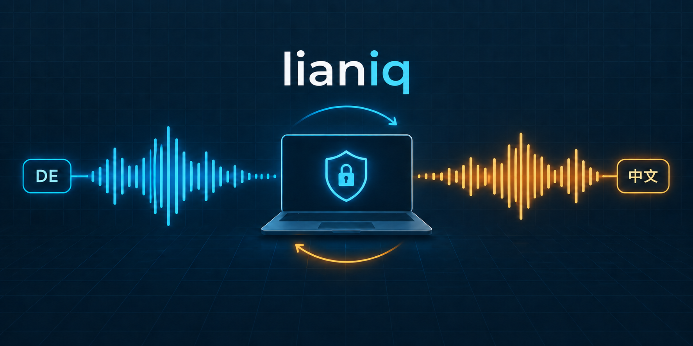
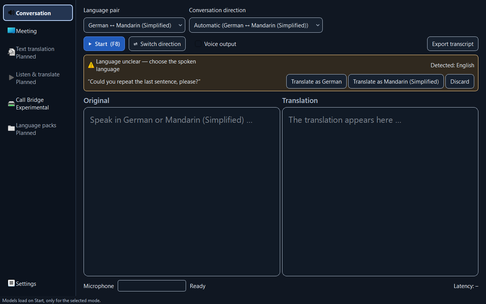

# lianiq



[](https://github.com/boris-heuer/lianiq/actions/workflows/ci.yml)
[](https://github.com/boris-heuer/lianiq/actions/workflows/codeql.yml)
[](LICENSE)

**Private, offline German-Mandarin and English-Mandarin speech translation for Windows.**

`lianiq` is a Windows desktop prototype for private, **near-real-time, utterance-based** conversations between
German or English and Mandarin Chinese. Audio is segmented at pauses, then transcribed, translated, and spoken;
it is not a simultaneous or word-by-word interpreter. Runtime audio processing and model inference
are local after the one-time model download.

> **Prototype status.** Results depend on language, noise, speakers, and hardware. Verify important
> conversations independently. The experimental Call Bridge is disabled by default and must not be
> used for calls until its hardware and call-application acceptance gates are complete.

The image above is the repository social-preview asset; it is an abstract illustration, not an
application screenshot or a performance claim.

### Application UI



This screenshot was captured by `scripts/capture_readme_screenshot.py` in the native test VM
(see [Native E2E VM setup](docs/native-e2e-setup.md)) with empty transcript panels, a synthetic
held turn in the held-turn bar, and the experimental Call Bridge disabled. It shows the sidebar
shell described under [Run](#run). It is not evidence that the hardware, latency, reconnect, or
real-call acceptance gates passed.

## Reference system and portability

The defaults were developed on this reference system:

- AMD Ryzen AI 7 350, 8 cores / 16 threads
- 64 GB RAM
- AMD Radeon 860M without CUDA support
- Windows 11 Pro and Python 3.12

Faster-Whisper `small` uses CTranslate2 CPU INT8 and MarianMT uses CPU worker threads. The Radeon
is not assumed to provide CUDA. This is a reference configuration, not a hardware requirement:
use the device selectors and measure the actual latency on your system with `scripts/benchmark.py`.

The default `auto` device setting selects CUDA independently for CTranslate2, PyTorch, and ONNX
Runtime when each backend reports a usable NVIDIA GPU. Any unavailable backend falls back to the
CPU, so a partial or missing CUDA installation does not prevent the application from starting.

## Architecture

```text
Microphone (16 kHz mono)
  -> energy-based speech and pause detection
  -> bounded real-time queue
  -> Faster-Whisper small (CPU INT8)
  -> MarianMT, one model per translation direction of the selected language pair
  -> voice per language: Piper (German, English), sherpa-onnx (Mandarin)
  -> selected speakers
```

Microphone processing is muted while a voice speaks, preventing the application from translating
its own output. If the bounded queue fills, the oldest pending segment is dropped to prevent the
conversation from accumulating increasing delay.

Languages are identified by BCP 47 language IDs from a built-in registry (`de` German,
`en` English, `zh-Hans` Mandarin (Simplified)); the pairs are German ↔ Mandarin (Simplified) and
English ↔ Mandarin (Simplified). Spanish and French are listed as planned and cannot be selected
yet; German ↔ English has no translation pack and is never offered. Automatic routing detects and routes every completed utterance independently, but
only within the selected language pair. It never assumes that participants alternate, so any number
of turns in either pair language may occur consecutively. See
[`docs/conversation-architecture.md`](docs/conversation-architecture.md) for multi-participant
scenarios, overlap limitations, and the TDD strategy.

## Experimental Call Bridge

The disabled-by-default Call Bridge places the application between a local headset and a call
application that permits explicit microphone and speaker selection, such as WeChat. Two independent,
fixed-direction translation lanes connect the
physical headset to two virtual audio cables without exposing the physical microphone directly to
the call application.

### Compatibility and limitations

The Call Bridge does **not** claim compatibility with every headset or communication application.
It is designed for Windows 11 audio devices that expose separate, unambiguous capture and playback
endpoints, and for desktop call applications that can route their microphone and speaker
independently to the two virtual cables. A technically compatible device selector is not evidence
that a real call, reconnect behavior, latency, or audio isolation has passed.

| Call application | Design assessment | lianiq real-call evidence | Production SystemOK |
|---|---|---|---|
| WeChat Desktop | Compatible in principle; it is the reference acceptance target | Pending | No |
| Microsoft Teams desktop | Compatible in principle where separate Speaker and Microphone selectors are available | Not run | No |
| WhatsApp for Windows | Conditional; the required independent TX/RX endpoint mapping must be confirmed for the installed version | Not run | No |
| Telegram Desktop | Conditional; the required endpoint controls and Windows microphone access must be confirmed for the installed version | Not run | No |
| Other desktop call applications | Conditional on explicit, independent microphone and speaker routing | Not run | No |

USB and wired headsets are generally the most predictable, but still require endpoint and real-call
validation. Bluetooth headsets may switch to a lower-quality mono/telephony profile or expose
different endpoints while their microphone is active. Compatibility depends on Windows, the
Bluetooth adapter and driver, and the exact headset model.

See the [Call Bridge compatibility policy](docs/call-bridge-compatibility.md) for support terms,
application evidence, headset constraints, and the acceptance required before changing any row to
`SystemOK`.

- [`docs/call-bridge-architecture.md`](docs/call-bridge-architecture.md) defines the technical
  architecture and audio routing decisions.
- [`docs/call-bridge-implementation-plan.md`](docs/call-bridge-implementation-plan.md) contains the
  risk assessment, TDD work order, scenarios, and acceptance gates.
- [`docs/call-bridge-system-ok.md`](docs/call-bridge-system-ok.md) records automated evidence and
  the remaining packaged-device/real-call production gates.
- [`docs/call-bridge-operator-setup.md`](docs/call-bridge-operator-setup.md) defines the Windows and
  call-application device mapping and real-call acceptance procedure.

The application persists native Windows MMDevice identities and resolves the current WASAPI index
at runtime. Missing or ambiguous devices mute the affected lane; they never fall back to a Windows
default endpoint. The lanes are fixed for a Call Bridge session: the local lane translates from
`call_bridge.local_language` (default `de`) to the other language of the selected pair, and the
remote lane translates back. Before any lane starts, the Call Bridge checks every model, both
voices, and all four endpoints, and names each missing item instead of starting.

The synthetic self-test needs no models. It checks that both lanes stay fixed for the session and
that a missing lane voice fails closed and is named. The model-backed run without `--synthetic`
needs every model and both voices. Both are local checks, not proof of safe hardware routing or a
working real call:

```powershell
.\.venv\Scripts\python.exe .\scripts\call_bridge_self_test.py --synthetic
.\.venv\Scripts\python.exe .\scripts\call_bridge_self_test.py
```

## Windows installation

Run in PowerShell from the project directory:

```powershell
Set-ExecutionPolicy -Scope Process Bypass
.\scripts\setup.ps1
```

The script:

1. creates a Python 3.12 virtual environment in `.venv`,
2. installs the hash-locked Windows dependencies and the application,
3. downloads Faster-Whisper, the four MarianMT models (German and English, each way with
   Mandarin), the German and English Piper voices, and the Mandarin sherpa-onnx voice (pinned
   revisions and archive, size and SHA-256 verified),
4. validates the installation with the offline doctor.

Model download is the only setup step that requires internet access. Instead of the script you
can also get each model from inside the app, by download or offline import (see
[Language packs](#language-packs)). Existing downloads are reused
from the Hugging Face cache. Spoken output is off by default (`languages.output` is `text`). The
Mandarin voice is the sherpa-onnx model in `models/sherpa/vits-icefall-zh-aishell3/`
(`tts.engines["zh-Hans"]`; see [MODEL_LICENSES.md](MODEL_LICENSES.md)); German and English use Piper. To
validate an existing installation without requesting models:

```powershell
.\.venv\Scripts\python.exe .\scripts\doctor.py
```

The doctor prints the readiness of each capability of the configured language pair: speech
recognition per language, translation per direction (for example `de>zh-Hans` and `zh-Hans>de`), and
the voice per language. A status is `not_configured`, `missing`, `installed` (files present),
`validated` (files match `models/model-manifest.json`), or `invalid` (files do not match).
Recognition and both translation directions are required. A missing voice is a warning, because
spoken output in that language then stays unavailable while text output works. Add
`--require-voices` to require the voices of both languages.

## Run

```powershell
.\.venv\Scripts\python.exe -m lianiq
```

Lianiq opens at 1280×720, or at the largest size that fits the screen, with **Conversation**
selected.

### The window

- **Sidebar.** Conversation, Meeting, Text translation, Listen & translate, Call Bridge (marked
  "Experimental") and Language packs, with Settings at the bottom. An entry that is not available
  yet is greyed out as "Planned" and cannot be opened. **Listen & translate** recognises speech in
  the chosen source language and shows each sentence with its translation; it never speaks. Click an
  entry, move with Up/Down and press Space or Enter, or press **Ctrl+1** … **Ctrl+7**. Below 1000 px window
  width the sidebar becomes an icon rail with the labels in the tooltips.
- **Session strip.** While a session starts, runs or stops, a strip below the workspace shows
  "Conversation running" (or "Meeting running", "Call Bridge running") and **Stop (F9)**, in
  every workspace. Only one session runs at a time: while a conversation runs, the Call Bridge's
  Start is disabled with "Stop the Conversation session first", and the reverse; **Start
  meeting** is refused the same way while another session runs, and theirs while a meeting runs
  or still finishes its contributions. Opening a workspace never starts or stops audio.
- **Notices.** A failure appears as a notice at the top of its workspace. It says what failed,
  for which mode, lane and language, whether recording and playback continue, and offers its
  action (**Retry**, **Reconnect**, **Choose device**). A blocking notice stays until its cause is
  resolved; **+N more** opens the notice history. The status bar only shows readiness and
  progress.
- **Settings.** *Audio devices* (Microphone, Speakers, **Refresh**, **Test microphone**, **Test
  speakers**), *Voice output* (the same voice switches as in Conversation, with the hint which
  voices Call Bridge and Meeting need) and *Diagnostics* (model
  profile, compute device, the readiness of the selected pair, and the notice history with
  **Copy** and **Export…**).

### Conversation

- `F8`: **Start**; `F9`: **Stop** the active session from any workspace.
- Choose the **Language pair**: German ↔ Mandarin (Simplified) or English ↔ Mandarin
  (Simplified), once its packs are ready; planned languages are shown as "planned, unavailable"
  and cannot be selected.
- Choose automatic direction within the pair, German → Mandarin (Simplified), or Mandarin
  (Simplified) → German. An unavailable entry is disabled, and its tooltip names what is missing.
- Choose the microphone and speakers in Settings › Audio devices before starting (see below).
- Choose which languages are spoken in the *Voice output* row (see below).

The language pair, direction, and the voice switches are bound at **Start**. While a session or
the Call Bridge runs, these controls are disabled; stop the session to change them.

No model is loaded before **Start**. **Start** loads only the models the selected mode needs:
speech recognition for the spoken language(s), the translation model of each direction in use, and
voices only when spoken output is on. A missing reverse translation model therefore does not block
a fixed direction. If a required model or device is missing, **Start** is disabled and the status
bar names each missing item.

#### Voice output

The voice row under **Start** (mirrored in Settings › Voice output) has one switch per language of
the pair, named `Speak <language>`, with the state of its voice next to it:

| State | Meaning |
|---|---|
| `<voice> · Ready` | The voice is provisioned; the switch is on unless you turned it off |
| *Voice missing* / *Voice files invalid* | The switch is off and disabled; **Open Language packs** gets the voice. That language is shown as text only, without a notice |
| `Not an output language in <direction>` | A fixed direction never speaks its source language |

A ready voice is spoken by default, also after an upgrade from the former single *Voice output*
checkbox. Each choice is saved in `tts.output`. A translation is always shown as text first and
then spoken. While it is spoken the state line reads "Microphone paused while the translation is
spoken" and the level meter shows 0, so Lianiq never translates its own voice.

- **Replay** speaks the latest spoken translation of the running session again, with the current
  voice options. Before anything was spoken its tooltip reads "Nothing to replay yet".
- **Stop playback** ends the current speech; the session keeps listening. **Stop** (F9) ends the
  speech and the session.
- **Voice options…** sits next to a ready voice whose engine offers at least one control. Each
  change is saved at once and the next spoken turn uses it, also in a running Conversation:

| Engine | Voice | Rate | Volume |
|---|---|---|---|
| Piper (German) | Only for a voice with several speakers | 0.75×–1.50× | 10–100 %, when the installed Piper supports it |
| sherpa-onnx (Mandarin) | When the model has several speakers; the dialog first shows "Loading voice…" while it reads their number | 0.75×–1.50× | — |

No voice is loaded before **Start**, **Replay** or a sherpa-onnx **Voice options…**. While a
Conversation runs its switches are locked, but **Voice options…** stays usable. Call Bridge and
Meeting keep the voice options of their Start: while one runs, **Voice options…** of its languages
says `Stop <mode> to change this voice`. Call Bridge always speaks both languages and needs both
voices; Meeting dual-mic needs the voice of the table language. If a translation cannot be
spoken, the notice `Could not speak the translation (<language>)` appears; the text stays and the
next turn is spoken again.

#### Held turns

In automatic mode, a turn is held instead of guessed when its language is outside the pair,
unknown, or detected with a probability below `languages.detection_min_probability` (default
`0.7`). The held-turn bar shows the transcript and the detected language. Choose **Translate as
German** or **Translate as Mandarin (Simplified)** to recognize the turn again in that language
and translate it, or **Discard** it. Later turns keep flowing while a turn is held, and **Stop**
discards any turn that is still held. **Export transcript** writes the `# lianiq transcript v2`
format with the language IDs of every turn, in capture order.

### Meeting

**Meeting** (sidebar, second entry, **Ctrl+2**) translates a face-to-face meeting with two
microphones at once: the customers speak Mandarin (Simplified) into a USB speakerphone on the
table, you speak German or English into your own microphone.

- *Your language* lists the two languages of the pair (German or English, and Mandarin
  (Simplified)); the other one is the *Table language*. It is locked while a meeting runs. The
  lines and labels below use the chosen language, e.g. "Speak English for me".
- Under *Table speakerphone* choose the *Table microphone* and *Table speaker* (choosing one
  suggests the other half of the same device). *Your microphone* follows the Windows default or
  a chosen microphone; it must not be the table microphone.
- The table's contributions appear as German "Table" lines, yours as German "You" lines, in
  speech-end order; Lianiq speaks your contributions in Mandarin (Simplified) on the table
  speaker. **Speak German for me** also speaks the table's contributions on *Output for German
  speech*; mark it *This output is a headset (no sound reaches the room)* only for a headset.
- While Lianiq speaks, the microphones that could hear it are muted and show *Muted while
  speaking …*; *Table microphone while Lianiq speaks Mandarin (Simplified)* chooses *Muted
  (recommended)* or *Open* for the table microphone. Contributions in the other language on an
  input are ignored and counted; nothing formed is dropped.
- **End meeting** offers to save a text transcript in both languages, only if something was
  translated. Audio is never saved, and the meeting runs fully offline.

See [`docs/meeting-architecture.md`](docs/meeting-architecture.md) for the roles, the feedback
guard, the privacy statement, the speakerphone setup (Jabra Speak2 75) and the known limits.

### Text translation

**Text translation** (sidebar, third entry, **Ctrl+3**) translates typed or pasted text offline,
in the selected pair, without a microphone or a running session.

- Choose the *Source language* and *Target language*; **Swap languages** exchanges them and keeps
  your text. Type or paste up to 5,000 characters into *Source text*; the counter turns into a
  warning above the limit and **Translate** stays disabled (your text is never cut).
- **Translate** (or **Ctrl+Enter**) shows the result in *Translation*; **Escape** cancels a
  running translation and keeps the previous result. Any edit or language change marks the result
  out of date until you translate again. **Copy source** and **Copy translation** copy the texts.
- **Play translation** speaks the result with the target language's voice on the Conversation
  speakers (Settings › Audio devices); **Stop** or **F9** (from any workspace) ends it, and the
  button then reads **Replay**. Playback is a session like Conversation: only one runs at a time.
- Only the translation pack of the chosen direction is needed; a missing voice only disables
  **Play translation**. **Open Language packs** next to a missing item opens the *Language packs*
  page (**Ctrl+6**) with **Get…** for it. On the first launch, or with **Run setup assistant** on
  that page, tick **Text translation**: the assistant lists both translation packs as "Needed by:
  Text translation" and the voices as optional.

The texts stay in memory: they are never written to settings, logs or Diagnostics, and the
page is empty after a restart. No network connection is made except by **Download** on the
Language packs page.

### Listen & translate

**Listen & translate** (sidebar, fourth entry, **Ctrl+4**) shows what one speaker says, sentence
by sentence, with its translation. It never speaks.

- Choose the *Source language*, the *Target language* (**Swap languages** exchanges them) and the
  *Microphone*. They are locked while listening.
- **Start listening (F8)** loads only speech recognition and the translation model and opens the
  microphone. Each completed sentence appears in *Transcript* with its time and translation;
  **Stop (F9)** keeps the text. **Copy transcript** and **Export transcript** write the
  `# lianiq transcript v2` format of the translated rows.
- If a pack is missing, **Open Language packs** installs it; see
  [troubleshooting](docs/troubleshooting.md#listen--translate).

### Audio devices

Settings › Audio devices lists the Conversation **Microphone** and **Speakers**. The first entry,
`Follow Windows default (now: <name>)`, uses the current Windows default; any other choice is
saved by device identity, so a reordered or replugged device stays selected. Devices with the same
name are numbered " (2)", " (3)"; no label or tooltip shows an endpoint ID.

- **Refresh** lists a device plugged in after start without restarting Lianiq. While a session or
  device test runs it only reports the change, and the lists refresh after **Stop**.
- **Test microphone** listens for up to 5 s and moves the meter; **Test speakers** plays a 1 s
  tone and asks whether you heard it. Both are disabled while a session runs.
- A saved device that is missing shows as "<name> — unavailable", and **Start** is refused with a
  notice offering **Choose device**; Lianiq never picks another device silently.
- If the microphone is unplugged during a conversation, recording stops and the transcript is
  kept; replug it and press **Reconnect**, then **Start**. If the speakers fail, the conversation
  continues as text.

The Call Bridge keeps its own four explicit endpoint selectors in the Call Bridge workspace and
never follows the Windows default.

### Language packs

Every model is a *language pack*: speech recognition (one pack for German, English and Mandarin), one
translation pack per direction, and one voice per language. The **Language packs** page
(Ctrl+6) lists them by group with their state (*Downloadable*, *Installing…*, *Installed*,
*Validated*, *Failed*), size and "Needed by"; Spanish and French sit in the collapsed
*Planned languages* group. The header shows the models folder with its free space and **Run
setup assistant**. Nothing connects to the network before you click **Download**.

- **Setup assistant.** It opens on the first launch (not after an upgrade, not with
  `--no-setup-assistant`) and again from **Run setup assistant**: tick what you want to do, check
  the conversation languages, test the microphone and the speakers, then review which packs and
  devices are ready, with **Get…** for each missing pack. **Skip**, Escape or **Finish** is
  remembered.
- **Get a pack.** **Get…** opens the pack details: source, model and version, languages,
  download and installed size, free disk space, licence, use constraints and the SHA-256 of
  every file. **Download** and **Import…** stay disabled until you tick *I accept the licence
  (…)*, and while the free space is too small. The row shows the bytes transferred with
  **Cancel**, then *Checking integrity… n of m files*, then *Validated*. Every workspace picks
  the new pack up without a restart.
- **Offline import.** In the pack details, **Import…** offers **Choose file…** (a `.zip`) and
  **Choose folder…**. The folder or the root of the `.zip` must hold `lianiq-pack.json` for that
  pack and every file it lists; only listed files are copied and each is checked against the
  built-in SHA-256. Every pack installed by this version's app or `scripts\download_models.py`
  holds this file, so its folder (for example `models\opus-mt-de-zh`) can be copied to a USB
  stick and imported on a computer without internet. Packs from older versions have no
  `lianiq-pack.json` and cannot be imported this way. A pack that does not match is rejected with
  the reason and nothing changes.
- **Remove, update, repair.** **Remove** names the usages that will not be ready afterwards and
  is refused while a running session uses the pack. *Update available* with **Update…** appears
  when the built-in catalog offers a newer version; the old version stays usable until the new
  one is checked. A pack with a missing or altered file is *Failed* with **Download again** and
  **Import…**. Only one pack job runs at a time.
- **Custom path.** If your settings point a model to a path other than the pack's folder, the
  row shows *Custom path* with the readiness of that path and offers no install or remove.

**Packs and a new release.** Packs live in the `models\` folder of the checkout or of each
installed version (`%LOCALAPPDATA%\Programs\lianiq\<version>\models`); versions do not share
them. `scripts\install-release.ps1` downloads and includes the packs for each new version. To
reuse the packs of an older checkout or version instead, copy its whole `models\` folder,
including `model-manifest.json`, over the new one while Lianiq is closed; its packs then show
*Installed*. Packs installed by this version or later can also be imported one by one on the new
version's Language packs page with **Import…** › **Choose folder…**.

### Diagnostics and troubleshooting

Settings › Diagnostics **Copy** and **Export…** produce the notice history as local text with
endpoint IDs, absolute paths and your user name replaced and no transcript text. See
[`docs/troubleshooting.md`](docs/troubleshooting.md) for each notice, device problem, language
pack problem, window scaling and the settings keys.

## Measure latency

Use your own 16 kHz mono PCM16 WAV files with spoken test sentences:

```powershell
.\.venv\Scripts\python.exe .\scripts\benchmark.py C:\path\german.wav --source de
.\.venv\Scripts\python.exe .\scripts\benchmark.py C:\path\mandarin.wav --source zh-Hans
```

`--source` takes the language ID spoken in the WAV file and fixes the direction to the other
language of the configured pair. Without it, the benchmark uses automatic routing within the pair.

The benchmark returns exit code `0` when end-to-end processing, including voice output, takes no
more than three seconds. Use `--without-tts` to measure STT and translation only.

After provisioning both reviewed voice models, run the fully offline synthetic self-test to exercise
both language directions through real STT, translation, and TTS models without requiring a person
to speak:

```powershell
.\.venv\Scripts\python.exe .\scripts\self_test.py
.\.venv\Scripts\python.exe .\scripts\ui_self_test.py
```

The UI self-test opens the real application window, starts the microphone, injects deterministic
speech, renders the result, plays the translated voice, then visits every enabled workspace, stops
the session with **Stop (F9)** from Settings, and checks that the transcript and pair are unchanged.

`scripts/capture_readme_screenshot.py --evidence <folder>` writes a screenshot of every enabled
workspace (Conversation, Call Bridge, Settings) at 850×560, 1120×720, 1280×720 and 1440×900 to that
local folder, with generic devices and no transcript, and prints one `<sha256>  <file>` line per
screenshot. Keep the screenshots local; record the SHA-256 lines as evidence.

## Check a language pair

`scripts\qualify_pair.py` translates a fixed set of 20 synthetic meeting sentences per direction
offline with the installed packs and writes a review sheet for a person to mark:

```powershell
.\.venv\Scripts\python.exe .\scripts\qualify_pair.py --pair en:zh-Hans --out C:\path\outside-repo
```

`review.md` lists each sentence with its translation, back-translation, a flag for Traditional-only
characters in Mandarin output and the latency, plus an empty *Accepted* column; `summary.json`
holds the counts, median latencies and peak memory. `--audio` also speaks each sentence with the
source voice and runs recognition first. Nothing is written inside the repository, and the exit
code is 0 whatever the result: the verdict is the reviewer's. English ↔ Mandarin (Simplified) is
qualified when at least 18 of 20 sentences per direction are accepted, every number and negation
sentence is correct and no Traditional character is flagged.

## Configuration and glossary

[`config/settings.json`](config/settings.json) contains safe repository defaults for audio
thresholds, model paths, and thread counts. Runtime selections, including private Windows endpoint
IDs, are saved to the ignored `config/settings.local.json` overlay. Both files use settings
schema v2 (`"schema_version": 2`). An older overlay without `schema_version` is migrated when it
is loaded; the first save keeps its original bytes once in the ignored
`config/settings.local.v1.json`. A legacy value that cannot be mapped stops the start with an error
naming the setting, and no file is changed.

Schema v2 keys every language setting by language ID:

- `languages`: the selected `pair`, `routing` (`bidirectional`, or `fixed` with `fixed_source`),
  `output` (`text` or `spoken`), and `detection_min_probability`;
- `speech_to_text.languages`: the languages the recognition model serves;
- `translation.edges`: one model per direction, keyed `"<source>><target>"`, such as
  `"de>zh-Hans"`; a reverse direction is never derived from a configured one;
- `tts.voices`: one voice file per language ID;
- `tts.output`: per language ID, `enabled` (omitted: on while the voice is ready), `speaker`,
  `rate` (0.75–1.5) and `volume` (0.1–1.0), as set in the voice row and **Voice options…**;
- `call_bridge.local_language`: the language spoken on the local side of the Call Bridge;
- `audio.input_policy` / `audio.output_policy` (`explicit` or `follow_default`),
  `audio.input_endpoint_id` / `audio.output_endpoint_id` and `audio.input_device_name` /
  `audio.output_device_name`: the Conversation devices by identity. A saved older index
  (`audio.input_device` / `audio.output_device`) is matched by name once and then set to `null`.
  Delete these six keys before running an older Lianiq build, which cannot read them.

Define domain terminology in
[`config/glossary.json`](config/glossary.json):

```json
{
  "de>zh-Hans": {
    "Ryzen AI": "锐龙 AI"
  },
  "zh-Hans>de": {
    "人工智能": "artificial intelligence"
  }
}
```

Glossary sections are keyed by translation direction (`"<source>><target>"` language IDs), and
terms apply only to their own direction. Older glossaries keyed `de-zh` and `zh-de` still load as
`de>zh-Hans` and `zh-Hans>de`. Longer glossary terms are replaced before shorter ones. The pipeline retains the last five
conversation entries. MarianMT translates the current sentence only for predictable latency and
quality; the context interface allows a later context-aware engine without changing capture or UI
code.

## Test and quality checks

```powershell
.\.venv\Scripts\python.exe -m pytest
.\.venv\Scripts\python.exe -m ruff check .
.\.venv\Scripts\python.exe .\scripts\check_markdown_links.py
```

Most automated tests use deterministic fakes and do not require a microphone, virtual cables, or
WeChat. See the [engineering case study](docs/engineering-case-study.md) for the evidence ladder
and the gates that still require a human operator. The phased publication evidence is tracked in
the [publication-readiness checklists](docs/publication-readiness-checklists.md). The automated
native rows run in a disposable Windows 11 VM; see [Native E2E VM setup](docs/native-e2e-setup.md).

## Windows build

```powershell
.\scripts\build.ps1
```

The result is written to `dist\lianiq`. By default this is a thin build containing the
application and configuration but no model weights. After reviewing every local model license, an
operator may explicitly create a local model-inclusive build with `scripts\build.ps1 -IncludeModels`.
Do not redistribute that output unless the corresponding model notices and source obligations are
satisfied. A directory build is used intentionally because it starts faster and handles large model
files more predictably than a single executable.

### Local release install

To use a tagged release on your own laptop, run from any checkout (no administrator rights needed):

```powershell
powershell -NoProfile -ExecutionPolicy Bypass -File .\scripts\install-release.ps1 -Version v0.2.0
```

The script clones the tag into its own build folder (default
`%LOCALAPPDATA%\lianiq-release\build\<version>`, change it with `-BuildRoot`), runs
`scripts\setup.ps1`, `scripts\build.ps1 -IncludeModels` and `scripts\doctor.py` there, and copies
`dist\lianiq` to `%LOCALAPPDATA%\Programs\lianiq\<version>`. The Desktop and Start-menu shortcuts
**Lianiq** then point at the newest installed version. Older versions stay installed, and your
`config\settings.local*.json` is carried over to the new version. To update, run the same command
with the newer version. An installed version or an existing build folder is replaced only with
`-Force`. The result contains model weights and is for your own use only. Each build folder keeps
its `.venv` and downloaded models (several GB); delete a version's build folder once it is
installed. Close Lianiq before replacing the version it runs from.

## Privacy and diagnostics

- Runtime code makes no network requests; all model loaders use local paths only.
- Transcript export happens only after the user chooses a local destination.
- Settings › Diagnostics keeps its notice history in memory; **Export…** writes it, redacted, only
  to a local file you choose.
- Rotating logs are stored in `logs\lianiq.log` and never contain audio.
- Native faults are written to `logs\native-crash.log`; Qt uses software rendering for stability
  on the integrated Radeon GPU.
- Missing dependencies and models produce actionable error messages.
- `scripts\doctor.py` validates dependencies and reports the readiness of every capability of the
  configured language pair.
- `scripts\self_test.py` validates both complete model pipelines against the three-second target.

## Model sources and licensing

- Speech recognition: `Systran/faster-whisper-small`
- Translation: `Helsinki-NLP/opus-mt-de-zh`, `Helsinki-NLP/opus-mt-zh-de`,
  `Helsinki-NLP/opus-mt-en-zh` (Apache-2.0) and `Helsinki-NLP/opus-mt-zh-en` (CC BY 4.0, attribution
  in [THIRD_PARTY_NOTICES.md](THIRD_PARTY_NOTICES.md))
- German voice: `rhasspy/piper-voices`, `de_DE-thorsten-medium`
- English voice: `rhasspy/piper-voices`, `en_US-ljspeech-high` (LJ Speech, public domain)
- Mandarin voice: sherpa-onnx `vits-icefall-zh-aishell3` (pinned release archive; licences and
  open provenance questions in [MODEL_LICENSES.md](MODEL_LICENSES.md))

The licence of each pack, as the pack details show it, is listed in
[MODEL_LICENSES.md](MODEL_LICENSES.md#language-pack-licences).

Review and redistribute all applicable package and model licenses with any binary distribution.
Review the license for the exact Piper runtime and voice artifacts selected for distribution.

## Contributing and support

- [Contributing guide](CONTRIBUTING.md)
- [Security reporting](SECURITY.md)
- [Support boundaries](SUPPORT.md)
- [Roadmap](ROADMAP.md) and [changelog](CHANGELOG.md)
- [AI-assisted development disclosure](AI_ASSISTED_DEVELOPMENT.md)
- [Citation metadata](CITATION.cff)

Maintained by [Boris Heuer](https://github.com/boris-heuer). Contributions and evidence-led
technical review are welcome.
